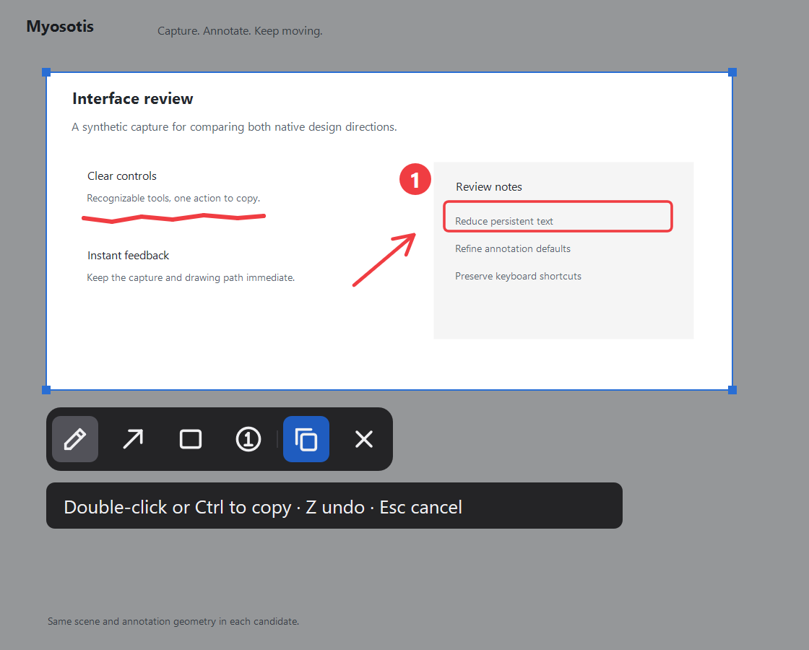
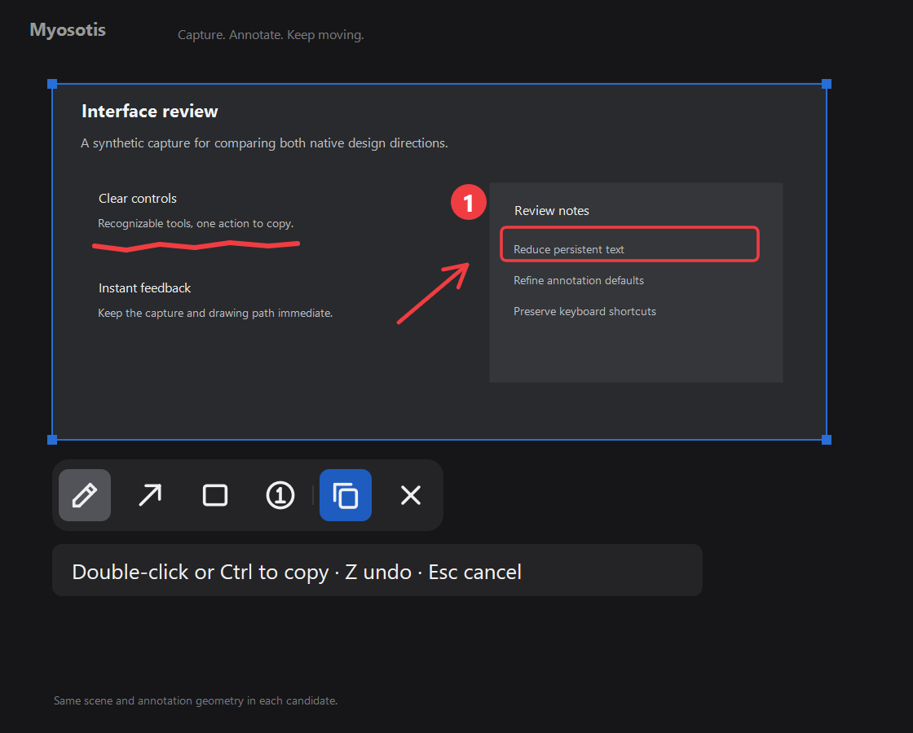

# Myosotis

### Talk is cheap, show them the pic.

Myosotis is a blazing fast screenshot widget based on Rust, human- and agent-friendly, no hassle, no clutters. Screenshot, scribble, and paste into your agent, all done within 0.5s.

Explaining a misplaced button can take longer than fixing it. Press **Ctrl+Alt+S**, select the area, draw what you mean, and press **Enter**. Paste the image into any chat, document, or issue that accepts images.

Need to sketch an idea instead? Right-click for a white canvas, or right-drag to choose its size.

## Get started

The native MVP supports **Windows 11 x64**. Download [version 0.1.1](https://github.com/nekoium/Myosotis/releases/tag/v0.1.1), extract the ZIP, and run `Myosotis/myosotis.exe`. It is a portable app using Windows graphics and image facilities; no additional application runtime is required. The executable is currently unsigned. macOS and Linux are planned.

### Install with Scoop

```powershell
scoop bucket add myosotis https://github.com/nekoium/Myosotis
scoop install myosotis/myosotis
```

This uses the project's own Scoop bucket. It creates a Start menu shortcut and a `myosotis` command. To update, run `scoop update myosotis`. Myosotis is not yet listed in the WinGet or Chocolatey community catalogs.

### Build from source

Install [Rust](https://rustup.rs/) with the MSVC toolchain and the Visual Studio Build Tools **Desktop development with C++** workload, including a Windows SDK. From the repository:

```powershell
cargo build --locked --release
.\target\release\myosotis.exe --capture
```

Myosotis stays in the notification area after you copy or cancel. Use **Ctrl+Alt+S** to capture again. Click its flower icon to capture, or right-click it for theme options and Quit. If Windows hides the icon, look under the notification area's overflow arrow.

Launching the executable again opens the resident app. The shortcut is fixed for this MVP; if another app owns Ctrl+Alt+S, Myosotis reports the conflict.

### Appearance and settings

Right-click the notification-area icon, open **Theme**, and choose **Dark** or **Light**. A radio mark shows the current choice. Dark is the default; changes apply immediately, including during a capture. The theme changes the toolbar and guidance panels. Screenshots, white canvases, and copied annotations keep their original colors.

Myosotis saves your choice in `%LOCALAPPDATA%\Myosotis\settings.toml` when you change the theme. If saving fails, the theme still applies for the current session and Myosotis reports the problem. Missing or invalid settings use Dark at startup.

To reset preferences, quit Myosotis and delete `%LOCALAPPDATA%\Myosotis`. This folder remains if you remove the portable executable; you can delete it yourself. No registry settings are created.

## See it in use

The default dark toolbar stays consistent across light and dark screenshots. These examples show the pen, arrow, rectangle, and numbered-mark tools.

| Light screenshot | Dark screenshot |
| --- | --- |
|  |  |

## Capture and sketch

The screen freezes when you invoke Myosotis.

- **Left-drag:** hold the left mouse button and move to select a screenshot region. **Left-click:** select the whole monitor under the pointer.
- **Right-drag:** hold the right mouse button and move to create a white canvas of that size. **Right-click:** use the whole monitor as a white canvas.
- Choose a drawing tool from the floating toolbar, then draw with the mouse or ordinary pen input. Hover over a toolbar button to see its name and shortcut.
- Hover over an edge or corner for a moment, then drag to resize. Marks stay where you drew them; anything outside the selected area is left out of the copied image.
- **Double-click**, press **Ctrl** on its own, press **Enter**, or click the **Copy** button to copy and close. Then paste into your chat or document with **Ctrl+V**.
- Press **Escape** or click the toolbar's **Cancel** button to cancel and keep your previous clipboard.

The toolbar and selection handles stay out of the copied image. If copying fails because another app holds the clipboard, your drawing stays open so you can press Enter to retry.

## Controls

The toolbar buttons run from left to right:

| Button | What it does | Keyboard shortcut |
| --- | --- | --- |
| Pen (pencil) | Draw a freehand line: hold the left mouse button and move | `1` |
| Arrow | Drag from the arrow's tail to where you want it to point | `2` |
| Rectangle | Drag between two opposite corners to outline an area | `3` |
| Numbered mark (circled 1) | Click to place the next number | `4` |
| Copy (overlapping pages) | Copy the finished image and close the capture | `Ctrl` on its own or `Enter` |
| Cancel (cross) | Close the capture without copying | `Esc` |

You can click a tool or press its number key. The selected tool has a gray background. Copy has a blue background.

The other controls depend on whether you have selected an area:

| When | Input | Action |
| --- | --- | --- |
| Any time outside a capture | `Ctrl+Alt+S` | Open Myosotis and freeze the screen |
| Before selecting | Left-drag / left-click | Select an area / select the whole monitor |
| Before selecting | Right-drag / right-click | Create a white canvas of a chosen size / the whole monitor |
| Before selecting | Double-click | Copy the whole monitor immediately |
| After selecting | Double-click | Copy the image and close |
| After selecting | Right-click | Switch between the screenshot and a white background, keeping your marks |
| After selecting | Hover on an edge or corner, then drag | Resize the selected area |
| After selecting | `Z` / `Y` | Undo / redo |
| After selecting | `R` | Clear all marks, keeping the area, background, and tool; undo with `Z` |
| During a capture | `Space` | Act like the left mouse button at the pointer: tap to click, or hold and move to drag |
| During a capture | Double-tap `Space` | Act like a double-click |
| During a capture | `Esc` | Cancel without copying |

Double-click quickly and keep the pointer nearly still. Myosotis uses its own short double-click timing, which may differ from your Windows setting. If the first click starts a mark, Myosotis removes that mark before copying. Double-click completion works inside or outside the selected area, except on toolbar buttons or while resizing. Mouse clicks and Space taps are counted separately.

## Privacy and limitations

Capture and annotation happen locally. Myosotis does not upload images, save captures to disk, or connect to your agent. It puts the finished image on the Windows clipboard as a bitmap and PNG. Windows clipboard history, synchronization, and other clipboard-reading applications can access it according to your system settings.

This MVP uses a fixed coral drawing color and preset line weights for each tool. Pressure sensitivity, erasers, editable shapes, custom shortcuts, and screen-reader access to individual drawn toolbar controls are not implemented. Keyboard shortcuts are available for every tool, copy, and cancellation.

HDR output, protected content, secure desktops, and mixed-DPI multi-monitor arrangements have not been fully validated. Changing the display arrangement during a capture cancels that capture. Keep a separate copy of anything important before closing an overlay; annotations are not saved between captures.

## Feedback

[Suggest an improvement](https://github.com/nekoium/Myosotis/issues). Check screenshots for private information before posting them.

## License

Myosotis is available under the [MIT License](LICENSE).
