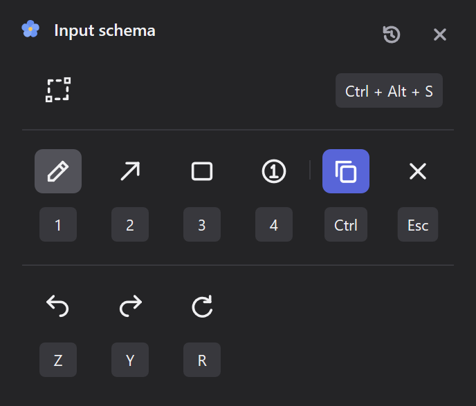

# Myosotis 0.2.1 — Guide it to your flow

## Your shortcuts, your rhythm

A quick screenshot should fit the way you work. Myosotis 0.2.1 puts your controls in one place, with shortcuts you can make your own.

Click the flower in your notification area to open **Input schema**. See your capture, drawing, copy, and history shortcuts at a glance. Click a keycap, press your preferred key, and keep going. Your changes save automatically, ready for the next capture.



## A little guidance, always close

- **Make room for your habits.** Change the capture shortcut and the overlay's tool, copy, cancel, undo, redo, and clear keys.
- **Find your way in one click.** Left-click the tray flower to open Input schema, or find it in the right-click menu.
- **Start fresh whenever you like.** The restore icon brings all shortcuts back to their defaults.
- **Keep your preferred input language.** Capture controls now work when a Chinese or Japanese input method is active.

The compact window follows your Dark or Light theme. Whether you're pointing out a detail or sketching an idea, the controls stay close to hand.

## Download and update

**Windows 11 x64 · Portable · No additional runtime required**

Quit the older Myosotis from its notification-area menu, extract `Myosotis-0.2.1-windows-x64.zip`, and run `Myosotis/myosotis.exe`.

Using Scoop? Quit Myosotis, then run:

```powershell
scoop update myosotis
```

If you use **Start at login**, turn it off before moving or deleting the previous portable copy. Enable it again from the new executable's location.

## Good to know

Capture shortcuts need Ctrl, Alt, or Win together with a key; overlay shortcuts use single keys. Space drawing, Enter completion, and mouse gestures stay fixed. Unsupported or conflicting choices leave your current shortcuts in place.

Myosotis works locally and copies your finished image to the clipboard. The executable is unsigned; macOS and Linux are planned. Real stylus hardware and some HDR, DPI, and multi-monitor setups remain unverified. See the [README](https://github.com/nekoium/Myosotis#privacy-and-limitations) for current limitations.
