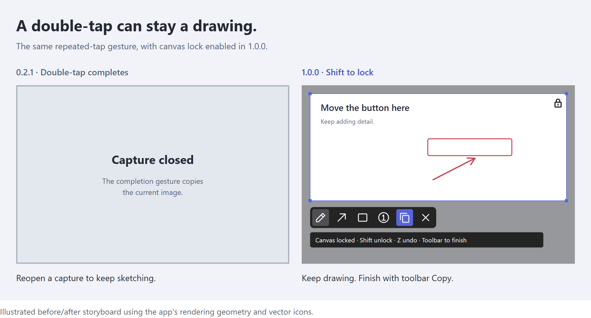
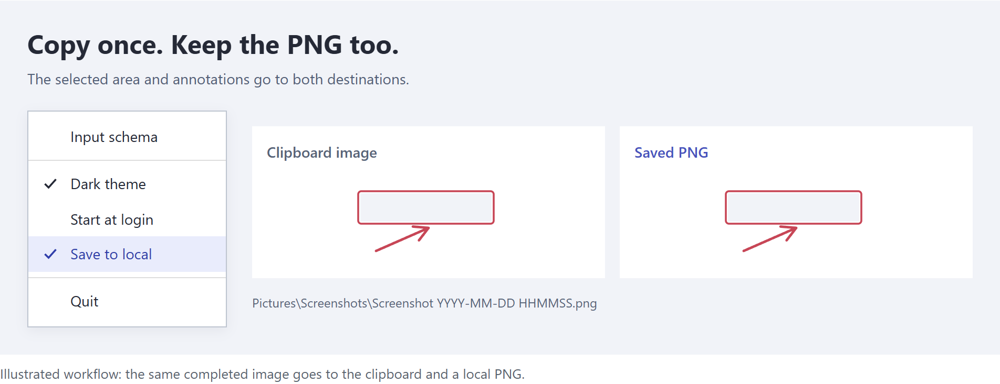
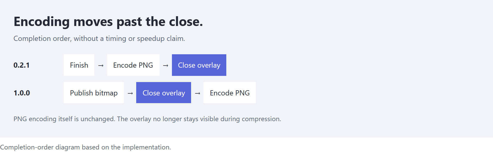
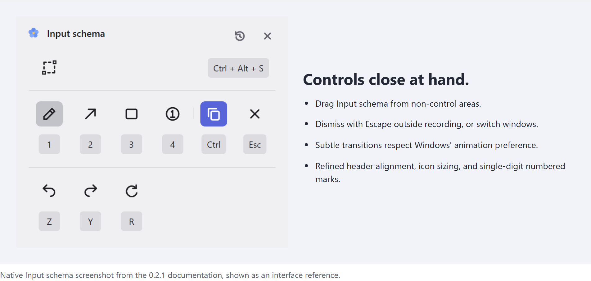

# Myosotis 1.0.0 — Capture it before you even realize

Press **Ctrl+Alt+S**, select a screenshot or white canvas, draw what you mean, and copy it into your chat, document, or issue.

Since 0.2.1, Myosotis adds protection for longer drawing sessions, optional local PNG saving, and background PNG encoding after the capture closes.

## Keep drawing until you're ready

Press **Shift** to lock the canvas. Double-clicks, pen double-taps, and repeated Space taps keep drawing instead of finishing. Copy and Cancel keyboard shortcuts are disabled while locked; use the toolbar buttons to finish, or press Shift to unlock. Each capture starts unlocked, and the padlock stays out of your finished image.

## Keep a copy

Enable **Save to local** in the tray menu to save each successfully copied capture as a PNG in **Pictures\Screenshots**. The file includes your selected area and annotations. Saving runs in the background, never overwrites existing files, and is off by default. Canceled captures create no file.

## Capture before you even realize

PNG compression now runs in the background after the overlay closes. Apps accepting bitmap clipboard data can paste immediately; apps requesting PNG before encoding finishes still wait for it.

## Small refinements, shown up close

- A simpler tray menu with a direct **Dark theme** toggle.
- Input schema dismisses on Escape outside shortcut recording or when you switch windows, stays out of the taskbar and Alt+Tab, and can be dragged from non-control areas.
- Subtle Input schema opening, closing, and control-color transitions respect Windows' animation preference.
- Refined header alignment, improved Windows icon sizing, and optical alignment for single-digit numbered marks.

## Download and update

**Windows 11 x64 · Portable · No additional runtime required**

Quit the older Myosotis from its notification-area menu, extract `Myosotis-1.0.0-windows-x64.zip`, and run `Myosotis/myosotis.exe`.

If you use **Start at login**, turn it off before moving or deleting the previous portable copy, then enable it from the new executable's location.
